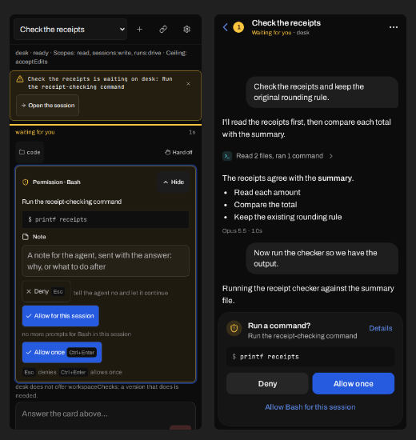
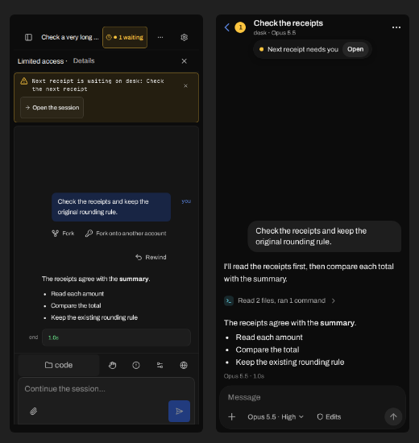
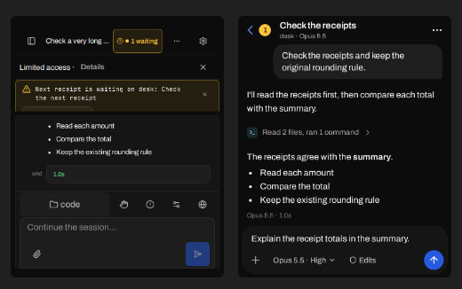
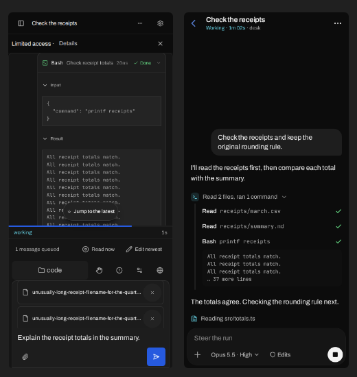
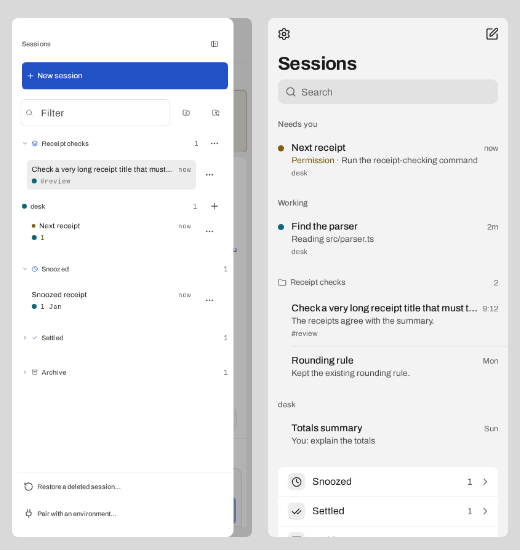
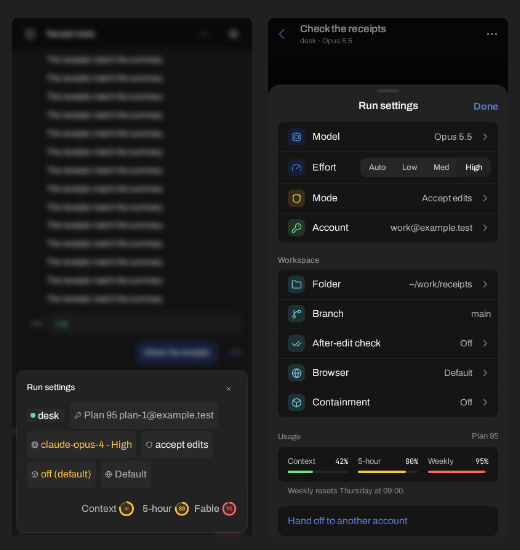
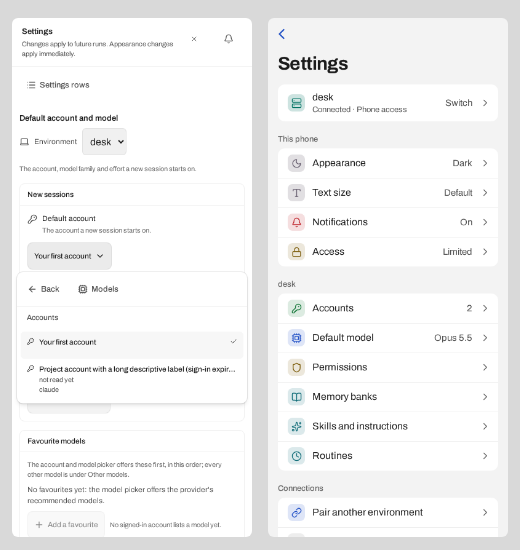
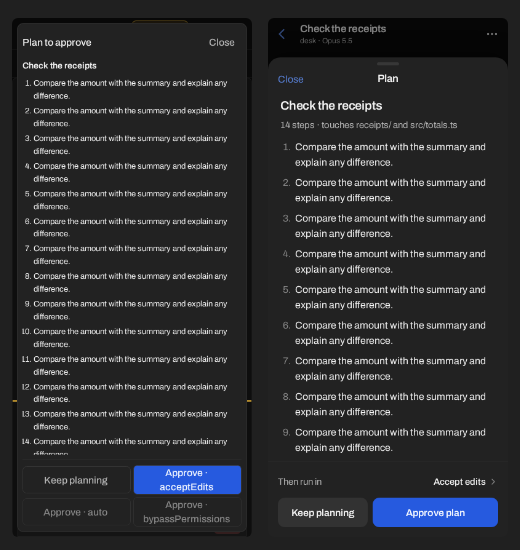
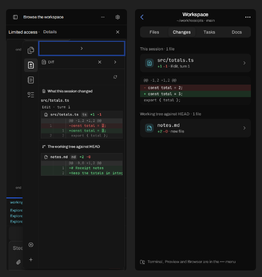
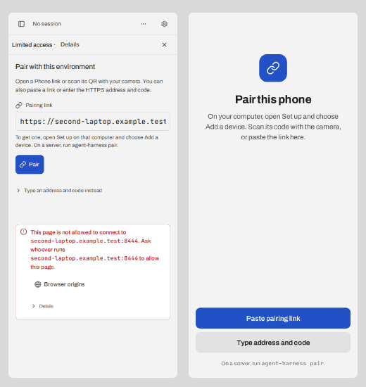

# Phone client audit and redesign proposal

Research for David's brief of 2026-10-13: the UI a paired phone sees "feels so
big and blocky and unintuitive/unrefined". This is a diagnosis, a proposed
phone design system, a navigation model with one screen per subsection,
before/after captures and a phased plan. Nothing here changes product code;
the prototypes are static mockups drawn with the theme's real tokens and fonts.

Evidence base: 59 captures of more than 50 distinct phone scenes from `packages/gui/gallery/baselines/`
(390 and 360 wide, keyboard and text-20 variants, dark and light, landscape),
the phone layout code (`platform/web-frame.tsx`, `frame/phone-frame.*`,
`ui/phone.ts`, `ui/phone-overlays.css`, `composer/phone-*`,
`settings/phone-*`, `prompt-card/phone-details.*`, `status/mode-sheet.tsx`),
`docs/specs/look.md` §1–§5 and §17, `docs/specs/web-client.md` "Phone layout
and input", ADR 0023 and the ADR 0006 phone amendment, plus the reference
research in §2. Prototype captures were rendered locally in headless Chromium
from the gallery build (see "How the captures were made" at the end).

## Executive summary

The phone client is not a phone design. It is the desktop window projected
onto a 390px canvas and then patched: `look.md` §17 says "Desktop dimensions
above still govern", and the phone layer is 56 `data-phone-frame` override
rules (12 of them keyed on `aria-label` strings, 9 `!important`) that force
every button to a 44px visible box, scale the whole desktop spacing system by
the phone text preset (16/14 = 1.14×), and stack five persistent bands of
chrome (header, access strip, notice banner, composer toolbar, composer) above
and below a bordered session card. Bordered boxes inside bordered boxes, mono
labels, raw identifiers (`acceptEdits`, `runs:drive`), keyboard hints (`Esc`,
`Ctrl+Enter`) and desktop-only items shown disabled with apologies make it
read as unrefined. There is no navigation model: a desktop sidebar becomes a
drawer, panes become an 85% side sheet with an icon rail, and Settings opens
a drawer of its own rows.

The proposal: give the phone its own presentation layer on the shared colour
tokens and shared behaviour. That means a phone type scale (body 16/24, row
labels 16, secondary 14, section labels 13), a 4pt spacing grid that does not
scale with text size, flat surfaces with elevation by tone instead of borders,
44px *hit areas* with smaller visible controls, a stack navigation (Sessions →
Conversation → Workspace; Settings as pages), one bottom-sheet primitive, and a
composer that is one rounded surface. At keyboard height the transcript goes
from 140px (29%) to 333px (69%) of the visible area; with no keyboard, chrome
goes from about 46% to about 22% of the screen. Six independent PR-sized
phases follow, foundation first.

## 1. Diagnosis

Each theme below names the captures (baseline file stem, 390 dark unless
stated) and the code behind it. "Confirmed" means the captures show it.

### 1.1 Desktop components re-flowed onto a 390px canvas (confirmed, root cause)

- How phone-ness is decided: `phoneLayoutMedia()` in `frame/phone-frame.tsx`
  (width < 640, or a coarse no-hover pointer at 640–960 wide and ≤ 500 high)
  drives `PhoneFrameProvider.narrow`, `usePhoneOverlay()` (`ui/phone.ts`) and
  `composer.tsx`'s `compact`. The same predicate is copied as a CSS media query
  in `ui/phone-overlays.css`, and `usePhoneSettings()`
  (`settings/phone-navigation.tsx`) uses a third, different test
  (`innerWidth < 640` on `resize`). Ten modules carry their own phone check.
- What is phone-specific: the header variant (`frame/header.tsx`), the
  drawer wrapper around the desktop `Sidebar`, the composer toolbar row, the
  sheet positioning. Everything inside them is the desktop component:
  `Sidebar` rows with their per-row `…` buttons, the desktop status chips in
  the run settings sheet, the desktop prompt card, the desktop Settings panes.
- The phone styles are an override layer, not a design. `ui/phone-overlays.css`
  sets `button[data-variant][data-size] { min-width: 44px; min-height: 44px;
  white-space: normal; overflow-wrap: anywhere }` for *every* button. A
  desktop 32px button with a 13px label becomes a 44px slab, and labels
  break mid-word: the question chip reads "Che / cks"
  (`phone-conversation-question`).
- The phone text preset is 16 on the desktop's 11–20 scale, which sets the root
  to 18.29px. Because desktop spacing, radii and control heights are in rem,
  *everything* grows 14%: 32px buttons become 36.6px before the 44px floor,
  16px card padding becomes 18.3px, the 54px session slot becomes 61.7px.
  Text size and density are coupled, so "bigger text" means "bigger boxes".

### 1.2 Too much persistent chrome (confirmed)

`phone-frame-conversation`: header 72px (session-drawer icon, title, a
bordered "1 waiting" chip, `…`, gear), "Limited access · Details ×" strip
45px, a cross-session notice banner 101px in mono with a boxed "Open the
session" button, the bordered session card, then a 48px toolbar (a big
"code" workspace chip plus four icon-only buttons) and the composer box
(97px). About 385 of 844px (46%) is chrome before a word of transcript.
At keyboard height (`phone-frame-conversation-phone-390-keyboard`, 480px
visible) the transcript gets 140px, four lines. `phone-gallery-permission`
adds a grant line ("desk · ready · Scopes: read, sessions:write, runs:drive ·
Ceiling: acceptEdits"), a "waiting for you" status row and a "code / Hand off"
row on top of the card.

The Limited access strip is permanent for the default Phone pairing preset (ADR
0006 amendment: Phone pairings are read/session-write/run-drive at
acceptEdits). So the normal state is presented as a warning.

### 1.3 Boxes inside boxes: "blocky" (confirmed)

`look.md` §1 gives every normal-flow card a hairline boundary, and §5 gives
cards 16px padding. On a phone that produces nested frames: the window body
inset (4px), the session card border, the prompt card's beam border, the
command well, the note textarea border, each button's border
(`phone-gallery-permission`). The same happens in Settings: page → bordered
"New sessions" card → bordered select → popover (`phone-settings-picker`), and
in Your machines: card → "Identity" card → field (`phone-connections-machines`).
The run settings sheet is a cloud of filled chips with no labels
(`phone-composer-details-run`). Elevation is never expressed by tone alone, so
every grouping costs a border and padding.

### 1.4 Type scale and spacing tuned for a 24px-row desktop (confirmed)

- The desktop scale has six steps from 11 to 20px and 400/500/600 weights,
  and the phone reuses it multiplied by 1.14. Headings are barely larger than
  body. Sheet and page titles are 14–16px semibold ("Run settings", "Mode",
  "Settings", "Sessions" as an 11px chrome label in the drawer). Nothing has
  the large-title or headline weight that phone platforms use to anchor a
  screen.
- Secondary text drops to 11–12px (drawer group labels, run picker
  descriptions in `phone-run-picker-effort`, the settings header subtitle),
  below what reads at arm's length, while controls are oversized. Small text in
  big boxes is what makes the screen feel both blocky and unrefined.
- Sheets disagree: the Mode sheet uses 16px rows with an outlined selection
  (`phone-mode-sheet`), the run picker 13px rows with Back/Next
  (`phone-run-picker-models`), and the prompt sheets 15px with a text Close
  (`phone-conversation-plan`).
- Archivo's word space collapses visibly at phone sizes in this renderer:
  "Snooz ed" (`phone-frame-drawer`) and "Checka very long" (both the current
  drawer and the prototype). This is a font-level issue, so it bears on
  question 6.

### 1.5 Mono for labels, raw identifiers for words (confirmed)

The notice banner is mono ("Next receipt is waiting on desk: …",
`phone-frame-conversation`), as are session times and counts in the drawer
("now", "1 Jan"), the end-of-turn pill "end 1.0s", the workspace chip and
path field (`phone-overlay-workspace`, 16px+ mono), and model ids under every
model name (`phone-run-picker-models`: "sample-model-quick"). Raw enum and
scope names reach the user: "Approve · acceptEdits", "Approve ·
bypassPermissions" (`phone-conversation-plan`), "above this connection's
ceiling (acceptEdits)" (`phone-mode-sheet`), "Scopes: read, sessions:write,
runs:drive" (`phone-gallery-permission`), "desk does not offer
workspaceChecks; a version that does is needed", "claude-fake" and "off
(default)" as unlabelled chips (`phone-composer-details-run`), and search
keywords printed beside each palette row (`phone-overlay-palette`).

### 1.6 Icon-only buttons with unclear meaning (confirmed)

The composer toolbar is a hand (Hand off), a circled "!" or "−" (after-edit
check state), sliders (Run settings) and a globe (Browser)
(`phone-compact-composer-inset`). The header uses the desktop's panel-left glyph
to open Sessions. The drawer has two unexplained folder icons beside Filter,
and every session row has its own `…` (`phone-frame-drawer`). The run settings
sheet ends with a lone gauge icon (`phone-composer-details-run`). None of these
is a symbol a phone user already knows.

### 1.7 Nested disclosure and sheets within sheets (confirmed)

- Run settings sheet → tap a chip → a second sheet with Back/Next paging
  through Accounts → Models → Effort (`phone-run-picker-*`), with Mode and
  Browser as further links in its footer. Other models stacks a second back
  control ("Back to the quick picks") under the sheet's own Back
  (`phone-run-picker-other-models`).
- Settings → "Settings rows" button → a drawer listing the rows → a page of
  bordered cards with "Details" and "What is this?" disclosures
  (`phone-settings-setup`, `phone-settings-full`), and dropdown popovers drawn
  over the page (`phone-settings-picker`).
- "Limited access · Details" → a centred dialog (`phone-limited-access-details`).
- More (`…`) → a long menu where a third of the items are disabled with
  desktop explanations ("Split needs a wide layout: at least 640px and not a
  short touch screen", "The embedded browser requires the desktop app")
  (`phone-more-full`).
- The prompt card on the dock has its own Hide/Details, and the permission
  detail is another sheet (`phone-client-permission`).

### 1.8 No clear navigation model (confirmed)

Sessions are a 360px drawer over the conversation; Files/Diff/Tasks/Documents
are a right-hand sheet at `min(480px, 85%)` with a vertical icon rail, a
"›" handle bar and a second "Files × ›" header, leaving a sliver of
transcript behind (`phone-pane-files`, `phone-pane-diff`, `phone-pane-tasks`,
`phone-pane-agent`). The terminal is a sheet offset from the left edge
(`phone-terminal`). Settings is a full-screen overlay with its own drawer.
Pairing replaces the conversation in place. There is no back stack, so the
browser's back gesture and the Android back button do nothing useful.

### 1.9 Desktop leftovers and unrefined states (confirmed)

- Keyboard hints on a touch screen: "Deny Esc", "Allow once Ctrl+Enter",
  "Esc denies · Ctrl+Enter allows once" (`phone-gallery-permission`,
  `prompt-phone-first-permission`).
- "Or scan this with your phone." under a QR code shown on the phone
  (`phone-sign-in-qr`, `phone-settings-full`).
- "Match my computer" as the theme choice (`phone-settings-theme-text-20`).
- Empty state: the app name, an icon tile, a "Not ready to run" bordered card
  with two link buttons, and two more buttons, under the access strip and
  the notice banner (`phone-frame-empty`).
- Push and attention settings are walls of explanatory text with plain-text
  buttons ("Enable push  Test push  Disable push") that do not look tappable
  (`phone-push-ready`, `phone-attention-empty-reader`).
- Search with the keyboard up floats the drawer mid-screen
  (`phone-session-search`). In landscape the drawer shows about one session row
  with the footer overlapping it (`phone-landscape-drawer-phone-844`).
- At 360×740 the notice banner is cut off by the session card, and its "Open
  the session" button shows only as a sliver (`phone-frame-conversation-phone-360`).
- At text 20 the header title shrinks to "Check…" because the bordered
  waiting chip keeps its width (`phone-frame-conversation-phone-390-text-20`).
- Two different phone headers coexist in captures: the drawer header and an
  older native-`<select>` header with `+`, link and gear
  (`phone-gallery-permission`, `prompt-phone-first-*`,
  `dialog-phone-first-pairing`). The second appears because phone-ness follows
  the window, not the container the client is drawn in.

### 1.10 What is good and must be kept

The behavioural work is strong and must survive any redesign. That covers
the single VisualViewport owner (`composer/phone-viewport.ts`), three
transcript lines reserved while composing, Send/Allow staying reachable at
keyboard height, focus trapping and restoring, drafts kept across drawer and
sheet changes, safe-area handling, overscroll containment, the 44px
hit-area rule, grant-aware controls, and the large gallery of phone scenes
with geometry checks. The problems are presentation and information
architecture, not plumbing.

## 2. What the references do that we do not

Sources were read on 2026-10-13. "(source)" means checked in the reference's
own code or official documentation. "(published)" marks standard platform
values whose pages render client-side and could not be fetched as text, with
the canonical URL to check. "(observed)" marks app behaviour described from use,
not from a document.

### 2.1 T3 Code (pingdotgg/t3code): the closest analogue

T3 Code is an "agent harness control surface" for Claude Code, Codex and others,
with a web app, an Electron desktop app and an Expo iOS/Android app. Phones pair
by QR code or link over LAN or Tailscale
([README](https://github.com/pingdotgg/t3code/blob/main/README.md),
`docs/user/remote-access.md`).

- **System fonts, a phone-tuned small-type scale** (source,
  `apps/web/src/index.css`): `-apple-system, BlinkMacSystemFont, "Segoe UI",
  system-ui`, with mono `ui-monospace, "SF Mono"`. The prompt is
  `max(…, 16px)`, commented as iOS zoom avoidance. The native app's scale
  (`apps/mobile/global.css`, DM Sans) is 11/14, 12/16, 13/17, 14/19,
  **16/23 base**, 18/23, 21/28, 26/32 and 30/36.
- **Phone gutters are 12px**, and 20px from 640px up, all plus
  `env(safe-area-inset-*)`. The chat column is capped at 46rem. html/body use
  `100svh` plus the top inset and `overscroll-behavior: none`, and the layout
  uses `h-dvh`.
- **The composer collapses on phones** (source, `ChatComposer.tsx`:
  `isComposerCollapsedMobile = isMobileViewport && !forceExpandedOnMobile &&
  !isComposerFocused && !hasMultilinePrompt`). Idle and single-line, it is one
  row (prompt text plus a 32px send) and expands on focus. The composer is a
  `rounded-3xl` card; send is a 36px circle. The native composer is 60pt
  collapsed and 156pt expanded, radius 26, with 12px side padding.
- **Approvals take the composer's place** (source,
  `ComposerPendingApprovalPanel.tsx` and `…Actions.tsx`). Typed headings
  ("Command approval", "File change approval"), a 1/N counter, a detail line
  scrolling within a small cap, and Approve / Always allow this session /
  Decline, with more behind a menu. On native, the request is a radius-20 card
  with a short eyebrow, an 18px bold title and the buttons "Allow once",
  "Allow session" and "Decline".
- **The work log is grouped and one line per call**
  (`chat/WorkLog.tsx`). A collapsible group header (chevron, icon, summary)
  holds rows of `min-h-6 text-sm` with a 24px icon column. An expanded group
  scrolls inside `min(18rem, 50dvh)` with fade edges, and details are indented
  28px and capped.
- **Conversation**: user messages are right-aligned bubbles
  (`max-w-[80%] rounded-2xl p-3`) and assistant messages are flat prose.
  Hover-only message actions show permanently on coarse pointers
  (`pointer-coarse:opacity-100`).
- **Thread list** (native): flat edge-to-edge rows (`px-5 py-2.5`) with inset
  hairline dividers, a status word per row (Approval / Input / Working /
  Waiting / Failed / Done), and swipe actions Archive / Snooze / Settle. Thread
  settings and git commit are bottom sheets. The web sidebar under 768px is a
  sheet `calc(100vw − 12px)` wide.
- **Modes**: four permission modes chosen in the composer per thread, and Chat
  vs Plan as a separate radio group in a compact controls menu.

What we lack by comparison: phone-specific type, a collapsing composer,
approvals that replace the composer, a one-line work log, status words on
session rows, and model/mode controls in sheets rather than a toolbar.

### 2.2 Claude (iOS/Android app, claude.ai, Claude Code on mobile)

- Claude Code on a phone is the **Code tab** of the Claude app, not a separate
  app. It reaches cloud sessions, projects and Remote Control sessions on your
  machine (joined from a QR code or the session list). Permission prompts and
  questions are answered from the phone, and push notifications fire when a task
  finishes or needs a decision. Cloud sessions offer Accept edits / Plan / Auto
  and Remote Control adds Manual. **Bypass permissions cannot be selected from
  the app** (source, [code.claude.com/docs/en/mobile](https://code.claude.com/docs/en/mobile)).
  This matches our Phone preset's acceptEdits ceiling, and argues for not
  showing bypass at all on phone rather than showing it disabled.
- Layout (observed): sessions and chats are a list (a left drawer in chat, a
  list in Code), user turns are rounded bubbles on the right, and assistant turns
  are flat full-width prose. The composer is one large rounded surface with "+"
  for attachments and tools, the model selector at the composer and a circular
  send. Pickers and attachments are bottom sheets. Tool use is collapsed to one
  line ("Ran a command", "Read a file") that expands on tap. Body text is about
  17pt with generous line height, and there are no borders around turns.

### 2.3 ChatGPT, Codex, Cursor (contrast; observed)

ChatGPT puts history in a left drawer, with a pill composer and "+", and a
model switcher in the title. Codex lists tasks with status and +N/−M diff stats
per task, and a task opens to a single-column per-file diff and logs. Cursor's
background agents use a mobile web list of agents, each opening to its chat.
The common thread: one list, one detail, everything else in sheets. Diffs are a
pushed page, never a side panel. (Check against
[developers.openai.com/codex/cloud](https://developers.openai.com/codex/cloud) and
[docs.cursor.com/background-agent](https://docs.cursor.com/background-agent).)

### 2.4 Platform guidance (published)

- **Apple HIG** ([typography](https://developer.apple.com/design/human-interface-guidelines/typography),
  [layout](https://developer.apple.com/design/human-interface-guidelines/layout)):
  - Touch targets at least 44×44pt.
  - Dynamic Type at the default size: Large Title 34/41, Title 1 28/34,
    Title 2 22/28, Title 3 20/25, Headline 17/22 semibold, Body 17/22,
    Callout 16/21, Subheadline 15/20, Footnote 13/18, Caption 1 12/16,
    Caption 2 11/13.
  - Navigation bar 44pt (about 96pt with a large title); tab bar 49pt plus a
    34pt home indicator.
  - Margins 16pt (20pt on larger phones); inset grouped lists with about 10pt
    radius and 44pt rows; sheets with medium and large detents.
- **Material 3** ([type scale](https://m3.material.io/styles/typography/type-scale-tokens),
  [bottom sheets](https://m3.material.io/components/bottom-sheets/specs)):
  - Body L 16/24, Body M 14/20, Title M 16/24 medium, Label L 14/20 medium.
  - A 4dp grid; touch targets at least 48dp; top app bar 64dp; navigation bar
    80dp.
  - Bottom sheet drag handle 32×4dp with a 28dp top radius; shape scale
    4/8/12/16/28.
  - Pressed state layer about 10%; list items 56/72/88dp for one, two and
    three lines.
- **Mobile web**:
  - Inputs at 16px or more, or iOS zooms on focus.
  - `viewport-fit=cover` with `env(safe-area-inset-*)` on bars, not the
    root, so backgrounds run under the notch.
  - `svh`/`dvh` units, with VisualViewport for the keyboard (we already do
    this well).
  - `overscroll-behavior: none` on the app root; `touch-action:
    manipulation` to remove the double-tap delay.
  - Primary actions at the bottom, where one-handed reach is best (Hoober,
    [UXmatters 2013](https://www.uxmatters.com/mt/archives/2013/02/how-do-users-really-hold-mobile-devices.php)).
  - Long output collapsed to a summary line, with expansion inside a capped
    scroller.

### 2.5 What they do that we do not

1. Phone type is its own scale (body 16–17, secondary 13–15, titles 20–34), not
   the desktop scale multiplied by 1.14.
2. Controls are as large as they need to be, and no larger: 36px visible send
   buttons inside 44pt hit areas, not every button drawn as a 44px slab.
3. Surfaces are flat. Turns, lists and the composer separate by tone and
   spacing, and borders are rare.
4. One list, one detail, back. Panes and settings are pages or sheets, never a
   side panel or a drawer inside a drawer.
5. The composer is one surface, compact when idle. Model and mode live in it or
   in a sheet, and there is no toolbar of unexplained icons.
6. A pending approval takes the composer's place, with three plainly worded
   answers.
7. Tool activity is one line per group, expanding into a capped scroller.
8. Session rows carry a status word, and attention sorts first. Row actions are
   swipe or long press, not a `…` on every row.
9. Things the phone cannot do are absent. Claude doesn't show Bypass at all.
10. Words are human ("Accept edits", "Allow session"). Raw identifiers and
    keyboard shortcuts never reach a phone.

## 3. Proposed phone design system

Principles: one thing per screen; content on the ground, controls in one
tone up; words before icons; nothing shown that the phone cannot do; text
size changes type, not boxes. Colours stay ADR 0023 tokens. No literal colour
appears in this document or the prototypes.

### 3.1 Type

Phone tokens (`--phone-text-*`), sans unless noted. Sizes are CSS px at the phone
default and scale with the text-size preference (§3.8).

| Token | Size / line | Weight | Tracking | Use |
| --- | --- | --- | --- | --- |
| display | 30 / 36 | 700 | −0.02em | Large page titles: Sessions, Settings |
| hero | 26 / 32 | 700 | −0.02em | Onboarding and pairing only |
| title | 20 / 26 | 600 | −0.01em | Headings inside content: plan title, empty state |
| headline | 17 / 22 | 600 | −0.01em | Top bar title, sheet title, card title |
| body | 16 / 24 (prose 16 / 25) | 400 | 0 | Transcript prose, list row label (16 / 22), inputs |
| callout | 15 / 20 | 400 / 500 | 0 | Row values, text buttons, secondary actions |
| subhead | 14 / 20 | 400 / 500 | 0 | Row second lines, tool rows, composer chips |
| footnote | 13 / 18 | 400 / 500 | 0 | Section labels (500, ink-faint, sentence case), footers, times |
| caption | 12 / 16 | 400 / 500 | 0 | Top-bar subtitle, metadata, meter labels |
| badge | 11 / 14 | 600 | 0 | Counts in badges only |
| mono-command | 13 / 20 | 400 | 0 | Commands, paths in wells |
| mono-output | 12 / 18 | 400 | 0 | Tool output, diff lines (12 / 20) |

Rules: inputs are always 16px or larger (iOS zooms below 16). Nothing below 11.
Mono is for machine text only: commands, paths, output, diffs, ids on
request. Times, counts and labels use sans with tabular numerals. Weights are
400/500/600 for UI and 700 for display and hero only. No uppercase labels.

### 3.2 Spacing

A 4pt grid that does **not** scale with text size: 2, 4, 8, 12, 16, 20, 24,
32, 40 (`--phone-space-*`). The screen margin is 16 (landscape:
`max(16px, env(safe-area-inset-left/right))`). Sheet content uses 16, or 20 for
reading text. List rows are 12 vertical by 16 horizontal. Transcript turns are
16 apart. Section gaps are 24, made of a 20 top and 6 bottom around a footnote
label. Related controls sit 8 apart; groups sit 24 apart.

### 3.3 Radii

| Token | px | Use |
| --- | --- | --- |
| radius-xs | 6 | Badges, keycaps |
| radius-sm | 8 | Wells (code, output, diff), small chips, icon tiles |
| radius-md | 12 | Grouped lists, buttons, search field, segmented controls |
| radius-lg | 16 | Docked cards |
| radius-sheet | 20 | Sheet top corners, user bubbles (bottom-right 6) |
| radius-composer | 22 | The composer surface |
| full | 9999 | Pills, icon buttons, send/stop, toggles |

Machine output keeps its square identity on desktop. On phone, wells sit inside
rounded cards and lists, where a square well looks like a rendering error, so
they take radius-sm (question 8).

### 3.4 Surfaces: flat first, borders rare, elevation by tone

| Layer | Token | Phone use |
| --- | --- | --- |
| Ground | `abyss` | Every page, transcript, top bar, large titles. No session card. |
| Group | `panel` | Grouped inset lists, the composer, docked request cards |
| Sheet | `float` | Bottom sheets, action sheets, menus, with the scrim below |
| Scrim | `scrim` at 45% | Under sheets; no backdrop blur (it smears transcript text) |
| Pressed | `wash-strong` | The pressed state layer on rows and icon buttons |
| Selected | `wash` | The current row in a list |
| Secondary fill | `wash-strong` + `ink` | Secondary buttons, the search field, segmented track, user bubble |
| Primary fill | `beam` + `beam-ink` | One primary action per screen |
| Well | `inset` | Commands, output, diffs |
| Separator | `hairline-strong` | Between rows in a list, inset past the icon column; never around cards |
| Edge | `hairline` ring 1px | The composer and docked cards only, so they read on light `abyss` |

Text uses `ink` (primary), `ink-muted` (secondary) and `ink-faint` (tertiary
and section labels). Text buttons, links and the back chevron use
`beam-text`. State colours: `amber` for waiting (badges on `amber`/`amber-ink`),
`cyan` for working and tools, `mint` for success, `signal` for errors and
destructive rows. Icon tiles in lists use the state colour at 15–20% on its
own hue, with the icon in that colour, so they theme with the seeds.

### 3.5 Touch targets and controls

- Hit areas are at least 44×44 (`look.md` §17 already requires it). The
  *visible* control may be smaller: icon buttons draw a 36px circle only when
  pressed, chips are 32 high, send/stop 36. A `touch-target` utility extends
  the hit area with an inset pseudo-element. The gallery's geometry check
  changes from "element box ≥ 44" to "hit box ≥ 44".
- Buttons: 44 high inline, 48 for sheet footers and the single primary action
  on a page; radius-md; 16px semibold labels on one line, never wrapped
  mid-word.
- Rows: min 48 (one line), 64 (two lines), 72 (three); height grows with
  text, never fixed.
- Segmented control 32–36 high; switch 50×30; search field 40 high.
- Primary actions live in the bottom third (thumb zone). Destructive actions
  are never the default and are never next to the primary without a gap.

### 3.6 Icons

Lucide, as today. 22px in bars (stroke 1.75), 17–18px in 28px list tiles,
16px inline with text, 14px in chips. Icon-only controls are limited to symbols
a phone user already knows: back, more (•••), close, search, new/compose,
attach (+), send, stop. Everything else carries a word.

### 3.7 Bars, safe areas and the keyboard

- Top bar: 52 high (44 content plus 8), on `abyss`, no border. A
  `hairline-strong` line fades in only when content scrolls under it. The bar
  takes `padding-top: env(safe-area-inset-top)`, so the ground runs under the
  status bar. Layout: leading back (chevron plus a waiting badge), a title of
  17/600 with a 12px subtitle, trailing •••.
- Bottom dock: the composer or a docked request, then
  `padding-bottom: max(8px, env(safe-area-inset-bottom))`. Nothing else stacks in
  the dock.
- The existing VisualViewport owner (`composer/phone-viewport.ts`), 100dvh
  fallback and `viewport-fit=cover` stay as they are. They work. The redesign
  removes rows from the dock rather than re-fitting them.
- Landscape: the same stack, with list and transcript margins taking the side
  insets.

### 3.8 Text size

On phone the root stays 16px. The 11–20 preference becomes a type multiplier
(`--phone-type-scale`, 1.0 at the phone default, 1.25 at 20) applied to the type
tokens only. Spacing, radii, bar heights and icon sizes are px. Rows grow with
their text through min-heights. This matches how Dynamic Type behaves and
removes the "bigger text, bigger boxes" coupling of §1.1.

### 3.9 Motion

Pushing or popping a page: 280ms, `cubic-bezier(0.32, 0.72, 0, 1)`, with the
incoming page sliding over from the right and the outgoing page moving 30%
left. Sheets: 300ms on the same curve from the bottom, scrim fading over
200ms. The pressed state is instant and releases over 150ms. No bounce or
scale. With `prefers-reduced-motion`, everything becomes a 150ms crossfade.
Haptics and custom swipe gestures stay out, per web-client.md. Back is the
bar's chevron and the browser's own history (§4.1).

## 4. Navigation model and screens

### 4.1 Model: a stack, not a drawer

```
Sessions (home)
 ├─ Conversation ──┬─ Workspace (Files | Changes | Tasks | Docs)
 │                 ├─ Terminal · Preview · Tool call detail
 │                 └─ sheets: Run settings, Model, Mode, Plan, Question, Request details, Message actions
 ├─ New session (a conversation page with an empty transcript)
 └─ Settings ──── Appearance · Notifications · Access · Accounts · Default model · …
```

Every page is a history entry (`#/s/<env>/<session>`,
`#/s/<env>/<session>/workspace/changes`, `#/settings/accounts`), so the
browser back gesture, the Android back button and the bar's chevron all do the
same thing. Sheets are not history entries, but back closes an open sheet first.
The desktop pane arrangement is still held and restored on wide layouts, as
today. The stack only changes the phone projection.

### 4.2 Sessions list (replaces the drawer)

```
[⚙]                                   [✎]
Sessions                         (display)
[🔍 Search                              ]
Needs you
 ● Next receipt                       now
   Permission · Run the receipt-checking…
Working
 ● Find the parser                     2m
   Reading src/parser.ts
📁 Receipt checks                       2
   Check a very long receipt title…  9:12
   The receipts agree with the summary.
desk
   Totals summary                     Sun
[ Snoozed 1 › | Settled 1 › | Archive 1 › ]
        Paired with desk · Phone access
```

- Full-screen page, not a drawer. Attention sorts first: "Needs you"
  (amber), then "Working" (cyan), then shelves and environments as they are
  today.
- Rows are a title (16/500) and one status or last-message line (14,
  `ink-muted`), with the time on the right in sans. Row `…` buttons go away.
  A long press opens an action sheet: Rename, Move to shelf, Snooze, Settle,
  Archive, Delete.
- Search is a field under the title (40 high). Results replace the list in
  place, and the field stays put above the keyboard.
- New session is the compose glyph top right. Settings is the gear top left.
  "Restore a deleted session" moves into Archive. "Pair with an environment"
  moves to Settings › Connections.
- The access state is one footnote line at the bottom, not a strip on every
  screen.

### 4.3 Conversation

```
[‹ ①]  Check the receipts              [•••]
       desk · Opus 5.5 · Working 1m 02s
          (Next receipt needs you  [Open])    ← transient pill, only for other sessions
                      ┌──────────────────────┐
                      │ Check the receipts … │  user bubble, wash-strong, right
                      └──────────────────────┘
I'll read the receipts first, …                 assistant prose on abyss, 16/25
[>_] Read 2 files, ran 1 command  ›             one line per tool group
The receipts agree with the summary. …
Opus 5.5 · 1.0s                                 turn footer, caption
╭─────────────────────────────────────────────╮
│ Message                                     │  composer (§4.4)
│ [+]  Opus 5.5 · High ▾   ⛉ Edits      (↑)  │
╰─────────────────────────────────────────────╯
```

- Goes: the session card border and inset, the access strip, the
  cross-session banner (it becomes the back badge plus a transient pill), the
  "end 1.0s" mono pill, the per-message Fork / Fork onto another account /
  Rewind row (tap a message → action sheet), and the Settings gear (it lives
  on Sessions).
- Status moves into the bar's subtitle ("Waiting for you" amber, "Working ·
  1m 02s" cyan). The top-bar ••• holds session actions: Workspace, Terminal,
  Preview, Run info, Fork, Rename, Copy link. Items the phone cannot do are
  absent, not disabled.
- Tool calls fold into one line per group (prototype 04). Tapping expands
  inline, and a long result opens a Tool call page with the input and the full
  output in a scrolling well. Delegated tasks appear as a row that pushes their
  transcript.
- Jump to latest is a 36px circular button above the composer, not a text
  pill over the transcript.

### 4.4 Composer and run settings

- One rounded surface (radius 22, `panel`, 1px `hairline` ring). The text box
  (16px, autosizing as today) sits above one row: attach `+`, a model chip
  ("Opus 5.5 · High ▾"), a mode chip ("Edits"), then send (36, `beam`) or stop
  (36, `ink` on `abyss`). Attachments appear as a horizontal strip of chips
  inside the surface.
- The 48px toolbar row goes. The workspace chip, Hand off, After-edit check and
  Browser move into Run settings. A failing check shows as a line inside the
  composer surface ("After-edit check failed · View"), not as an icon state.
- Tapping either chip opens **Run settings**, a sheet with a large detent
  (prototype 06). It is a grouped list: Model ›, Effort (segmented Auto / Low /
  Med / High), Mode ›, Account ›. Then Workspace: Folder ›, Branch,
  After-edit check ›, Browser ›, Containment ›. Then Usage as three labelled
  meters with words, and "Hand off to another account". Model › pushes a page
  *inside the sheet*: favourites first, then "Other models" as a further page.
  Model ids appear only as a detail line on request. Mode › pushes the mode
  list with human names and one-line descriptions. Above-ceiling modes read
  "Not allowed for this phone" with a link to Access.

### 4.5 Prompt cards: permission, denylist, question, plan

- **Permission** (prototype 01): the request *replaces the composer* in the
  dock. A `panel` card (radius 22) holds a 32px amber shield, a headline as a
  question ("Run a command?"), the summary line, the command in a mono well,
  then Deny (secondary) and Allow once (primary) side by side at 44 high, and
  "Allow Bash for this session" as a full-width text button. Details (top
  right) opens a sheet with the full input, the reason and an optional note.
  There are no keyboard hints.
- **Denylist / ceiling refusals**: the same card, with an `signal` icon tile,
  the refusal in words ("This phone can't allow that: the environment's
  denylist blocks `rm -rf`") and one button, OK. Technical detail sits behind
  Details.
- **Question**: a short question docks like the permission card. Each option
  is a 52px radio row (label plus description), with "Other…" as a last row that
  expands a 16px field. A long or multi-topic question opens a large-detent
  sheet with Skip and Send answers in a sticky footer. Topic tags become a
  "1 of 2" stepper, not a chip.
- **Plan** (prototype 08): a large-detent sheet with Close leading, the plan
  title (20/600), a summary line ("14 steps · touches receipts/ and
  src/totals.ts") and the rendered steps. A sticky footer holds "Then run in:
  Accept edits ›" (one row, opening the mode list) and Keep planning /
  Approve plan. The four "Approve · <enum>" buttons become one choice and
  one button.

### 4.6 Attention and notices

- A session that needs you elsewhere shows as the amber badge on the back
  chevron and once as a transient pill under the bar ("Next receipt needs
  you · Open"), which auto-hides after 6s. It also tops the Sessions list
  under "Needs you".
- Environment-wide notices (update available, connection blocked) become one
  row at the top of Sessions with an action, never a banner in the
  conversation. A blocked connection replaces the conversation's dock with a
  card ("desk is unreachable · Pair again").
- Toasts (sonner) sit above the dock, 44 high, one line, `float`.

### 4.7 Settings

```
[‹]
Settings                              (display)
[ ▣ desk                         Switch › ]   environment, replaces the <select>
   Connected · Phone access
This phone
[ Appearance Dark › | Text size Default › | Notifications On › | Access Limited › ]
desk
[ Accounts 2 › | Default model Opus 5.5 › | Permissions › | Memory banks › | … ]
Connections
[ Pair another environment › | Reload client ]
```

- A page stack of grouped inset lists (prototype 07). The "Settings rows"
  drawer, the header copy ("Changes apply to future runs…"), the bell and the
  native environment `<select>` go away.
- Each row pushes a page with a back chevron labelled with the parent. Pages
  use grouped lists, switches and segmented controls rather than bordered cards
  and dropdowns. Explanatory text becomes a footnote under its group (13px,
  `ink-faint`), at most two lines, with "Learn more" for the rest.
- "This phone" collects the client-local settings: Appearance (System / Light
  / Dark), Text size, Notifications (push on/off, routine completions toggle,
  Send test), Access (what this pairing can do, Change access…).
  Desktop-only settings (embedded browser, Machines' advanced options, Split)
  are absent, not disabled.
- Provider sign-in on phone: "Open sign-in page", then a code field with
  Paste. No QR (it is on the phone already).

### 4.8 Pairing and connections

- First run (prototype 10): a centred hero ("Pair this phone"), two sentences,
  and two bottom buttons: Paste pairing link (primary) and Type address and code
  (secondary). The server hint is a footnote. A refused origin is an inline
  error card with one action, not a red-bordered box of mono text.
- Settings › Connections lists each environment as a row (status dot, name,
  "Phone access"). A row pushes its page: Access, Re-pair, Forget.

### 4.9 Pane views: Files, Changes, Tasks, Docs, Terminal, Preview

- One **Workspace** page pushed from the conversation's ••• (prototype 09),
  with a segmented control (Files | Changes | Tasks | Docs) under a centred
  title and a subtitle ("~/work/receipts · main"). It replaces the 85% side
  sheet, its icon rail and its double header.
- Files is a grouped list with folder rows that push. A file opens a reader
  page (mono 12/20, horizontal scroll in the well, Copy and Download in •••).
  Changes is grouped by "This session" and "Working tree against HEAD", each
  file a row that expands to its hunks. Tasks are rows with status and time,
  pushing the task's transcript.
- Terminal is a full-screen page with an accessory row above the keyboard (Esc,
  Tab, Ctrl, arrows) and Close in the bar. "Add to session" sits in •••.
- Preview is a page with the sandboxed snapshot and the existing explanation
  as a footnote.

## 5. Before and after

Each image is the current baseline (left) beside the prototype (right), at
390×844 (390×480 for the keyboard), reduced to 240px wide per phone.

| | |
| --- | --- |
|  | **Permission.** Five chrome bands and a bordered card with keyboard hints become a bar, the transcript and one docked request with three plainly worded answers. |
|  | **Idle conversation.** The access strip, mono banner, session card and toolbar go. The other session's request becomes a badge and a pill, and the composer is one surface. |
|  | **Keyboard up.** The transcript goes from 140px (four lines) to 333px of the 480px visible. |
|  | **Tool output.** Nested bordered tool cards with JSON input become a one-line group, expanded here, with a short output well and a "more lines" tail. |
|  | **Sessions.** The drawer with per-row `…`, icon buttons and a big blue button becomes a page that sorts by attention and has search and compose in standard places. |
|  | **Run settings.** Unlabelled chips become a labelled grouped list with values, a segmented effort control and usage in words. |
|  | **Settings.** A header paragraph, a rows drawer, a native select and nested cards with a popover become one grouped list page. |
|  | **Plan.** Four "Approve · <enum>" buttons become "Then run in: Accept edits" and one Approve plan. |
|  | **Workspace.** The 85% side sheet with an icon rail and double header becomes a pushed page with a segmented control. |
|  | **Pairing.** A form under a toolbar becomes a first-run screen with two thumb-reachable actions. |

The prototype sources are in `phone-redesign/prototype/` (`kit.tsx` holds the
proposed tokens as Tailwind classes on the theme's colour utilities). To render
them, copy the folder to `packages/gui/gallery/proto/` and run
`make-scenes.mjs` as its header describes. They are not committed gallery
scenes, so they need no baselines.

## 6. Phased implementation plan

Each phase is one PR an engineer agent can take independently once the phase
before it has merged. Every phase regenerates the phone baselines it touches.
Hosted gallery capture and acceptance (`docs/agents/gallery.md`) are the proof,
so each PR waits for the relay runners. Desktop captures must not change, and
any desktop pixel difference is a bug in that PR.

1. **Foundation: tokens, type, spacing, hit areas.**
   - Add `packages/gui/src/phone/tokens.css` (`--phone-text-*`,
     `--phone-space-*`, `--phone-radius-*`, bar heights) and Tailwind theme
     entries for them, scoped to the phone projection.
   - Decouple the text-size preference from spacing on phone (§3.8), where
     the root size is set.
   - Replace the global 44px button rule and `overflow-wrap: anywhere` in
     `ui/phone-overlays.css` with a `touch-target` hit-area utility, and add a
     `hitArea` geometry check in `gallery/geometry.ts` and
     `gallery/scene-registry.ts`.
   - Unify the phone predicate: `usePhoneSettings` uses `phoneLayoutMedia`.
   - Apply the font decision (question 6).
   - Rewrite `look.md` §17 as "Phone design system" and point `web-client.md`
     at it.
   - Proof: a new `phone-foundation-specimen` scene (type ramp, buttons, rows,
     a sheet header) and re-accepted phone baselines with no layout changes
     beyond type and spacing.
2. **Navigation shell.** Add a phone stack with history entries in
   `platform/web-frame.tsx` and `frame/phone-frame.tsx` (the drawer goes), a
   phone top bar in `frame/header.tsx` (back plus badge, title and subtitle,
   •••), a new `phone/sessions-page.tsx` on `runtime.projections.sessionList`
   and the shelves, and a row action sheet. Move `connections/limited-access.tsx`
   to Settings › Access plus a footnote. Give `notices/window-notices.tsx` a
   pill and Sessions-row variant, and `frame/header-menu.tsx` a session-actions
   variant. Proof: `phone-sessions-list`, `phone-sessions-search` (replacing
   `phone-frame-drawer` and `phone-session-search`), `phone-frame-empty`,
   `phone-landscape-sessions`, and `phone-session-actions` (replacing
   `phone-more-*`).
3. **Conversation and composer.** On phone: a flat transcript (no session
   card), user bubbles, message actions in an action sheet, tool-group lines
   and a Tool call page, a turn footer instead of "end", status in the bar, and
   the composer as one surface with model and mode chips. A pending request
   replaces the composer. Files: `composer/composer.tsx`,
   `composer/phone-conversation.css`, `status/status-line.tsx`,
   `transcript/*`, `fork-rewind/*`, `prompt-card/prompt-card.tsx`,
   `prompt-card/phone-details.tsx`. Proof: `phone-frame-conversation`,
   `phone-gallery-*`, `phone-conversation-*`, `phone-long-request-*`,
   `phone-compact-composer-*`, `phone-keyboard-dock`,
   `phone-transcript-reading`, `phone-client-permission`,
   `phone-install-conversation-*`, `phone-landscape-conversation`,
   `phone-landscape-keyboard`.
4. **Sheets and pickers.** Add one `ui/phone-sheet.tsx` (grabber, a
   Cancel/Title/Done header, medium and large detents, a scrolling body, a
   sticky footer, visual-viewport bounds, pages inside the sheet). Migrate
   `composer/phone-composer-sheet.tsx`, `status/mode-sheet.tsx`, the run-sheet
   popper override in `ui/phone-overlays.css`, `status/pickers.tsx`,
   `new-session/chips.tsx` and `new-session/control.tsx`, `ui/dialog.tsx`'s
   phone surface and `palette/*`. Build Run settings as a grouped list, use
   human mode names everywhere, and show model ids only on request. Proof:
   `phone-composer-details-*`, `phone-mode-sheet`, `phone-run-picker-*`,
   `phone-new-session-picker-*`, `phone-overlay-*`,
   `phone-landscape-details`.
5. **Settings, pairing and attention.** Make Settings a page stack of grouped
   lists with an environment row (dropping `settings/phone-navigation.tsx`'s
   drawer and the header copy), add This phone › Appearance, Text size,
   Notifications and Access, use the phone sign-in flow without QR, and rebuild
   the pairing first-run and the Connections pages. Files:
   `settings/settings-view.tsx`, `settings/phone-settings.css`,
   `connections/*`, `attention/*`, `accounts/*`, `appearance/*`, and
   `setup/checklist-view.tsx` (phone footer only). Proof: `phone-settings-*`,
   `phone-connections-*`, `phone-attention-*`, `phone-push-*`,
   `phone-install-*`, `phone-sign-in-qr`, `phone-access-change`,
   `phone-limited-access-*`, `phone-pairing-unlisted-origin`,
   `dialog-phone-first-pairing`.
6. **Workspace pages and polish.** Add a Workspace page (Files | Changes |
   Tasks | Docs) replacing the side-column sheet and rail on phone, a terminal
   page with an accessory row, and a Preview page. Add the push and sheet
   motion, empty, loading and error states, a text-20 and landscape pass, and
   PWA metadata (`theme-color` from `abyss` at runtime, status bar style).
   Files: `side-column/*`, `grid/session-pane.tsx`, `terminal/*`,
   `documents/*`, `platform/browser-boot.ts` and the web HTML entry,
   `theme/paint.ts`. Proof: `phone-pane-*`, `phone-terminal-*`,
   `phone-landscape-*`, and a new `phone-states` scene (empty, loading,
   offline).

## 7. Questions for David

Each has a recommended answer (**R**) and a one-line consequence per option.

1. **Navigation model.** **R: (a).**
   - (a) A stack: Sessions page → Conversation → Workspace, with Settings as
     pages and browser back working everywhere. The conversation gets the
     whole screen, and switching sessions costs one back tap.
   - (b) Keep a left drawer, restyled. It is familiar from chat apps, but
     the drawer competes with the transcript and has no back model for panes.
   - (c) A bottom tab bar (Sessions, Needs you, Settings). Attention is always
     one tap away, but it costs 49px plus the home indicator on every screen,
     including at keyboard height.
2. **How much desktop parity on phone.** **R: (b).**
   - (a) Everything, disabled where impossible. That is today's More menu:
     clutter and apologies.
   - (b) Converse, approve, run settings, sessions, read-only Workspace,
     terminal when granted, and a phone-relevant Settings subset. Desktop-only
     items are absent, with one "Open on desktop" footnote where someone would
     look for them. Some admin edits (machines, skills, banks) then need a
     computer.
   - (c) Conversation only. That is simplest, but you lose files, diffs and
     terminal on the go.
3. **Density.** **R: (b).**
   - (a) Airy, like Claude's app: 17px body, generous rows. It reads
     beautifully, but long agent runs mean a lot of scrolling.
   - (b) Comfortable: 16px body, 48–64px rows, tool calls folded to one line.
     Prose reads well and runs stay scannable (the prototypes).
   - (c) Dense, like a coding tool: 14–15px body, 40px rows. More fits on a
     screen, but text is small and it feels like desktop again.
4. **Light or dark default.** **R: (a).**
   - (a) Follow the system, as today. It matches the phone, and both ladders
     must stay polished.
   - (b) Default dark. One ladder gets most attention, but phones in light
     mode get a dark island.
5. **May the phone diverge visually from desktop?** **R: (a).**
   - (a) Yes: shared colour tokens, components' logic and copy, with a separate
     phone presentation layer (type, spacing, radii, surfaces, navigation).
     `look.md` §17 becomes its own system, and the desktop rules stop
     governing phone.
   - (b) No: keep projecting desktop. The issues in §1 stay structural.
6. **Font on phone.** **R: (a).**
   - (a) The system stack for UI text (`system-ui, -apple-system, Roboto`),
     with JetBrains Mono kept for machine text. It feels native, has tuned
     metrics at small sizes, avoids the collapsed word spaces seen in §1.4 and
     ships less font. The phone looks less like the desktop.
   - (b) Keep Archivo. Brand consistency, but the spacing artefacts need
     fixing at the font level.
7. **Home Screen (PWA) behaviour.** **R: (a).**
   - (a) Standalone display, `theme-color` following `abyss` at runtime, a
     translucent status bar with the top bar padding under it, and in-app back
     plus history (iOS standalone has no browser back gesture). It looks like
     an app, and every page must offer its own back.
   - (b) Browser chrome (`minimal-ui`). Simpler, but it uses about 100px of
     browser chrome and push on iOS still needs a Home Screen install.
8. **Machine-output wells on phone.** **R: (a).**
   - (a) Radius 8 inside rounded cards and lists. It looks deliberate, but it
     departs from desktop's square-output rule on phone only.
   - (b) Keep them square everywhere. Consistent with desktop, but square
     wells look broken inside a rounded card.
9. **The "Limited access" strip.** **R: (a).**
   - (a) Remove it from the conversation. Settings › Access shows it, Sessions
     has a footnote, and an action that needs more access says so where it
     happens. Normal Phone pairings stop looking like a warning.
   - (b) Keep a one-line strip. The access state is always visible, but every
     screen loses 45px forever.
10. **Message actions (Fork, Fork onto another account, Rewind).** **R: (a).**
    - (a) Tap or long-press a message to get an action sheet. The transcript is
      clean, but the actions are less discoverable (the first run can show a
      hint).
    - (b) Always visible under each message, as today. Discoverable, but noisy
      on every turn.
11. **A pending permission request.** **R: (a).**
    - (a) It replaces the composer in the dock until answered. The answer is
      always at the thumb, and you can't type a new message while a request
      waits; Details offers a note.
    - (b) An inline card in the transcript plus the composer. You can keep
      typing, but two competing bottoms at keyboard height.
12. **Text-size preference on phone.** **R: (a).**
    - (a) It scales type only, with layout growing through min-heights. That is
      Dynamic Type-like and keeps density stable, but the gallery's text-20
      geometry checks need rewriting.
    - (b) It scales everything, as today. Simple, but bigger text means bigger
      boxes.

## How the captures were made

The "before" images are the committed baselines, unchanged. The "after"
images were rendered from the gallery build (`pnpm --filter
@agent-harness/gui build-gallery`) with the prototype components mounted as
temporary component scenes (they paint the default theme through
`derive(DEFAULT_THEME)`, like every component scene). They were captured by a
scratch Playwright script in Chromium's headless shell at 390×844,
`deviceScaleFactor` 1, dark and light. The browser and its shared libraries
were unpacked into a scratch folder in the worktree and removed afterwards;
nothing was installed system-wide, and the repository's hosted-only
`gallery/capture.ts` was not modified or run. The relay runners were offline,
so no hosted render was requested.
